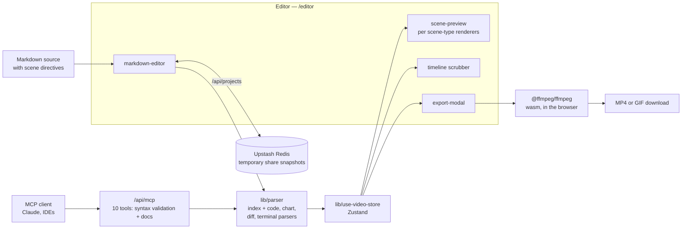
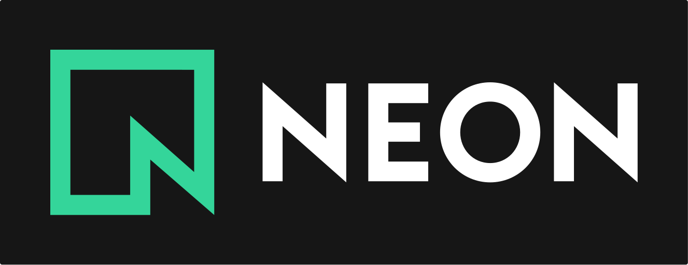

# 🎬 Markdown to Video

Transform your Markdown into animated videos with a custom syntax that brings your content to life. Markdown to Video is a Next.js-based web application that converts Markdown content into videos with rich animations, transitions, and scene types.


## ✨ Features

- **MCP server** — an [MCP](https://modelcontextprotocol.io) endpoint at `/api/mcp` exposes 10 tools (`validate_syntax`, `parse_markdown`, `list_directives`, `get_directive_docs`, `search_docs`, `get_examples`, `get_suggestions`, `generate_template`, `quick_check`, `quick_reference`) so a coding agent can author and validate scenes against the same parser the editor uses.

- **Custom Markdown Syntax**: Write videos using an intuitive extended Markdown syntax with custom directives
- **Rich Scene Types**: Support for text, code, images, terminal, diffs, charts, mockups, QR codes, countdowns, progress bars, and more
- **FFmpeg.wasm Export**: Render and download MP4 videos or animated GIFs in the browser
- **Real-time Preview**: See your video content as you edit it with live scene previews
- **Errors as you type**: Unknown directives and invalid values are marked on the line that caused them, with one-click fixes for typos
- **Autocomplete**: Directive names after `!`, and allowed values for properties like `transition`, `animation:` and `type:`
- **Advanced Animations**: Multiple animation types including typewriter, slide, fade, bounce, and custom effects
- **Particle Effects**: Add confetti, snow, rain, sparkles, and fireworks to your scenes
- **Code Syntax Highlighting**: Beautiful syntax highlighting for multiple programming languages
- **Scene Transitions**: Smooth transitions between scenes (fade, slide, wipe, zoom, magic effects)
- **Terminal & Diff Support**: Render terminal commands and code diffs with syntax highlighting
- **Chart Rendering**: Create animated charts (bar, line, pie, donut) embedded in videos
- **Video Variables**: Define and reuse variables throughout your markdown
- **Local Projects**: Autosave one document in browser storage, and open/save it as a `.mdv` file; there is no multi-project library yet
- **Keyboard Shortcuts**: Boost productivity with keyboard shortcuts for common editor actions
- **Find & Replace**: Quickly edit content across your markdown
- **Theme Support**: Light and dark theme with customizable color schemes
- **Experimental Sharing**: Generate links that open a project in the editor; large-project links require a configured Redis backend and expire after 7 days. There is no dedicated embed player yet; iframe embeds currently expose the editor UI

> **Platform note:** The editor is designed primarily for modern desktop browsers. Mobile editing is not optimized yet, and browser-based export can be resource-intensive for longer videos.

## 🤖 Use it from an AI agent (MCP)

The hosted MCP server lets Claude, Cursor or any MCP client write and check scenes with the same parser the editor uses.

Claude Code:

```bash
claude mcp add --transport http markdown-video https://markdown-video-theta.vercel.app/api/mcp/mcp
```

Cursor, Windsurf and other clients that take a JSON config:

```json
{
  "mcpServers": {
    "markdown-video": {
      "url": "https://markdown-video-theta.vercel.app/api/mcp/mcp"
    }
  }
}
```

Then ask your agent something like *"Write a 30-second markdown_video script announcing our v2 release, and validate it."*

## 🏗️ Architecture



Rendering and export both happen client-side — the parser produces scenes, the preview draws them,
and FFmpeg compiles the same scenes to MP4 or GIF in the browser. Nothing is rendered on a server.

## 🏗️ Project Structure

```
app/
  ├── layout.tsx              # Root layout
  ├── page.tsx                # Landing page
  ├── editor/
  │   └── page.tsx            # Video editor interface
  ├── api/
  │   ├── projects/route.ts   # API endpoint for temporary share snapshots
  │   └── mcp/[transport]/    # MCP server (10 tools over the parser)
  └── globals.css
components/
  ├── landing/                # Landing page components
  ├── ui/                     # Reusable UI components (50+ Radix UI based)
  └── video-editor/
      ├── markdown-editor.tsx     # Markdown input editor
      ├── scene-preview/          # Video scene renderer
      │   ├── scenes/             # Different scene type renderers
      │   ├── components/         # Preview helpers
      │   └── utils/              # Rendering utilities
      ├── timeline.tsx            # Timeline scrubber
      ├── export-modal/           # Video export with FFmpeg
      ├── templates-panel.tsx     # Template selection
      ├── theme-selector.tsx      # Theme customization
      └── keyboard-shortcuts.tsx  # Shortcuts reference
lib/
  ├── mcp/
  │   ├── syntax-validator.ts # Validation shared with the MCP tools
  │   └── documentation.ts    # Directive docs served over MCP
  ├── parser/
  │   ├── index.ts            # Main markdown parser
  │   ├── parsers/            # Specialized parsers for different scenes
  │   ├── constants.ts        # Scene types and directives
  │   ├── timeline.ts         # Timeline parsing
  │   └── utils.ts            # Helper utilities
  ├── types.ts                # TypeScript type definitions
  ├── use-video-store.ts      # Zustand video state management
  ├── redis.ts                # Redis client for share snapshots
  ├── github.ts               # GitHub API integration
  ├── templates.ts            # Template definitions
  └── utils.ts                # General utilities
public/
  ├── og-image.png            # Open Graph image for sharing
  └── site.webmanifest        # PWA manifest
```

## 🚀 Getting Started

### Prerequisites

- Node.js 18+ or higher
- pnpm, npm, or yarn

### Installation

1. **Clone the repository**:

   ```bash
   git clone https://github.com/Avik-creator/markdown_video.git
   cd markdown-to-video
   ```

2. **Install dependencies**:

   ```bash
   pnpm install
   ```

3. **Set up environment variables** (optional for local development):

   ```bash
   cp .env.template .env.local
   ```

4. **Run the development server**:

   ```bash
   pnpm dev
   ```

5. **Open the application**:
   Visit [http://localhost:3000](http://localhost:3000) in your browser

## 🛠️ Technologies Used

- **Framework**: [Next.js 16](https://nextjs.org/) - React framework with SSR
- **UI Components**: [Radix UI](https://www.radix-ui.com/) - Unstyled, accessible component library
- **Styling**: [Tailwind CSS 4](https://tailwindcss.com/) - Utility-first CSS framework
- **State Management**: [Zustand](https://zustand-demo.pmnd.rs/) - Lightweight state manager
- **Markdown Parsing**: Custom parser with extended syntax support
- **Video Rendering**: [FFmpeg.wasm](https://ffmpeg.org/ffmpeg.js/) - Browser-based video encoding
- **Screenshot to Canvas**: [HTML2Canvas Pro](https://html2canvas.hertzen.com/) - DOM to canvas rendering
- **Animations**: [Framer Motion](https://www.framer.com/motion/) - React animation library
- **Database**: [Upstash Redis](https://upstash.com/) - Optional serverless Redis backend for large share links
- **Icons**: [Lucide React](https://lucide.dev/) - SVG icon library
- **Toast Notifications**: [Sonner](https://sonner.emilkowal.ski/) - Toast notification system
- **Themes**: [Next.js Themes](https://github.com/pacocoursey/next-themes) - Theme switching

## 📦 Available Scripts

- `pnpm dev` - Start the development server with hot reload
- `pnpm build` - Build the application for production
- `pnpm start` - Start the production server
- `pnpm typecheck` - Type-check the project with `tsc`
- `pnpm test` - Run the test suite with Vitest

## 🤝 Contributing

Contributions are welcome! To contribute:

1. Fork the repository
2. Create a feature branch (`git checkout -b feature/AmazingFeature`)
3. Commit your changes (`git commit -m 'Add some AmazingFeature'`)
4. Push to the branch (`git push origin feature/AmazingFeature`)
5. Open a Pull Request

## 💖 Sponsors

markdown_video is free and open source, and maintained in my spare time. If it saves you time, or your company builds on it, consider [sponsoring the project on GitHub](https://github.com/sponsors/Avik-creator). Sponsorship pays for maintenance, new scene types, and keeping the hosted editor online.

### Sponsored by

<a href="https://neon.com">
  
</a>

[Neon](https://neon.com) supports markdown_video through the Neon Open Source Program.

## 📄 License

markdown_video is released under the [MIT License](LICENSE). You can use, modify, and distribute it, including for commercial purposes, as long as the copyright notice is kept.

> Code before v1.0.0 was published under CC BY-NC 4.0. From v1.0.0 on, the project is MIT-licensed.

## 👏 Acknowledgments

Built with amazing open-source libraries:

- [Next.js](https://nextjs.org/)
- [React](https://react.dev/)
- [Radix UI](https://www.radix-ui.com/)
- [Tailwind CSS](https://tailwindcss.com/)
- [Zustand](https://zustand-demo.pmnd.rs/)
- [FFmpeg.wasm](https://ffmpeg.org/ffmpeg.js/)
- [Framer Motion](https://www.framer.com/motion/)

## 📧 Support

For questions, issues, or suggestions, please [open an issue](https://github.com/Avik-creator/markdown_video/issues) on GitHub.

---

Made with ❤️ by [Avik Mukherjee](https://github.com/Avik-creator)
